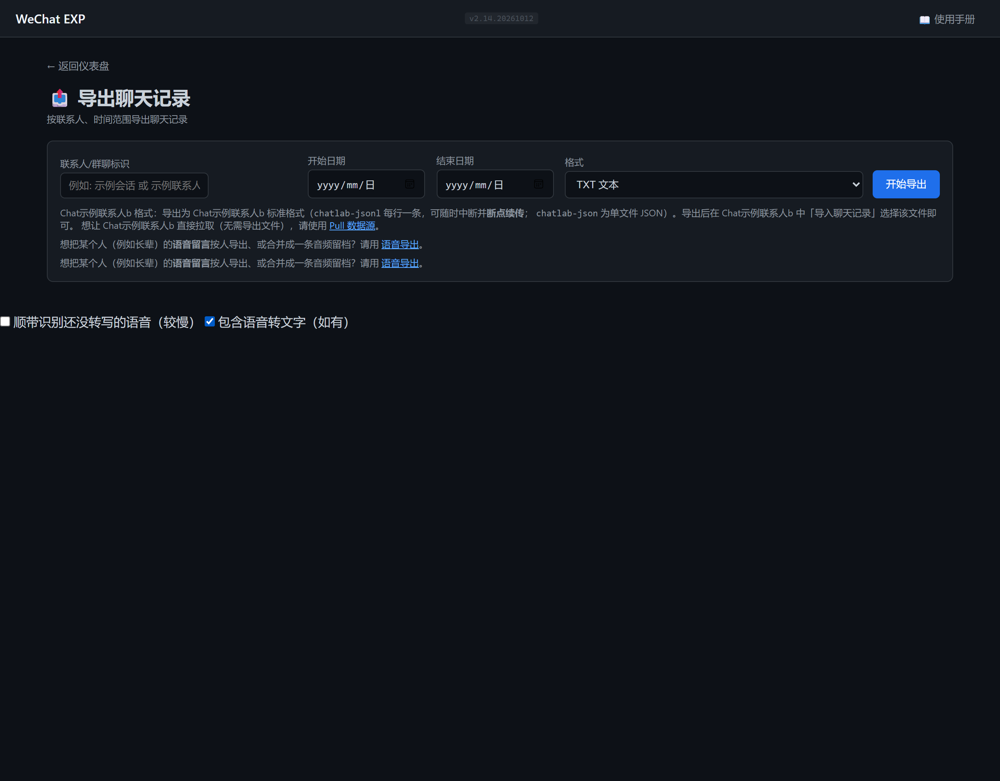
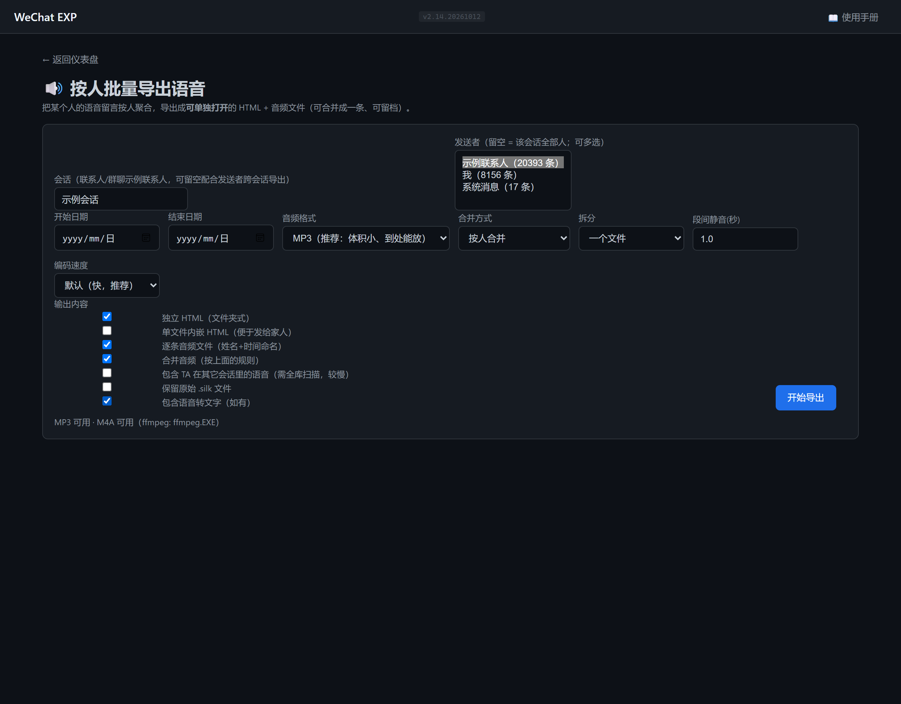

# WeChat EXP 使用手册

> 版本：2.13.20261012 | 更新日期：2026-10-12 | 适用 WeChat 4.x（已测试 4.1.9 / 4.1.10 / 4.1.12.55 / 4.1.15.11）| Windows 10/11

---

## ⚠️ 重要警告 — 请务必阅读

**本工具仅供个人学习、研究和技术交流使用。使用者必须遵守以下规定：**

1. **仅限个人数据**：您只能备份、查看和分析**您自己的**微信聊天记录。未经他人明确同意，**严禁**获取、查看、分析他人的微信数据。
2. **禁止非法用途**：严禁将本工具用于任何侵犯他人隐私、窃取商业秘密、进行网络监控等违法违规活动。
3. **自行承担责任**：使用者对自身行为负全部法律责任。本工具的开发者不对任何滥用行为承担责任。
4. **遵守法律法规**：请遵守您所在地区的法律法规。在中国境内，未经授权的个人信息收集和处理违反《个人信息保护法》。
5. **数据安全**：本工具在本地运行，不会将您的任何数据上传到互联网。但解密后的数据存储在您的电脑上，请妥善保管。

> **如果您不同意上述条款，请立即删除本工具及其所有相关文件。**

---

## 目录

1. [快速开始（只需 2 步）](#1-快速开始只需-2-步)
2. [系统要求](#2-系统要求)
3. [Web 界面功能详解](#3-web-界面功能详解)
   - [3.1 仪表盘首页](#31-仪表盘首页)
   - [3.2 数据采集 — 一键备份](#32-数据采集--一键备份)
   - [3.3 浏览与分析 — 聊天查看器](#33-浏览与分析--聊天查看器)
   - [3.4 浏览与分析 — 年度报告](#34-浏览与分析--年度报告)
   - [3.5 浏览与分析 — 词云分析](#35-浏览与分析--词云分析)
   - [3.6 导出 — 聊天记录导出](#36-导出--聊天记录导出)
   - [3.7 导出 — 语音留言（按人批量导出 / 自动转 WAV）](#37-导出--语音留言按人批量导出--自动转-wav)
   - [3.8 导出 — 综合报告](#38-导出--综合报告)
   - [3.9 导出 — 员工报表](#39-导出--员工报表)
   - [3.10 Pull 数据源 — 让 ChatLab 直接拉取](#310-pull-数据源--让-chatlab-直接拉取)
   - [3.11 工具 — 垃圾清理、密钥提取与解密数据库](#311-工具--垃圾清理密钥提取解密数据库)
   - [3.12 手动输入密钥（已有密钥的用户）](#312-手动输入密钥已有密钥的用户)
   - [3.13 设置 — 语音转写引擎（本地模型 / 百度语音识别）](#313-设置--语音转写引擎本地模型--百度语音识别)
4. [聊天查看器使用详解](#4-聊天查看器使用详解)
   - [4.1 界面布局](#41-界面布局)
   - [4.2 搜索联系人](#42-搜索联系人)
   - [4.3 消息筛选](#43-消息筛选)
   - [4.4 消息类型展示](#44-消息类型展示)
   - [4.5 语音转文字](#45-语音转文字)
   - [4.6 群组信息查看](#46-群组信息查看)
5. [V2 图片显示问题](#5-v2-图片显示问题)
6. [常见问题 (FAQ)](#6-常见问题-faq)
7. [附录：命令行参考（高级用户）](#7-附录命令行参考高级用户)

---

## 1. 快速开始（只需 2 步）

WeChat EXP 是一款 Windows 平台下的微信聊天记录**备份、查看与分析**工具。下载后双击即可使用，无需安装 Python 环境。

**主要功能一览：**

| 功能 | 说明 | 在哪里操作 |
|------|------|-----------|
| 一键备份 | 自动备份微信聊天记录（含图片、视频、文件、语音） | Web 仪表盘 → 数据采集 |
| 聊天查看 | 像微信一样浏览聊天记录，支持搜索、筛选 | Web 仪表盘 → 聊天查看器 |
| 图片查看 | 查看微信中的图片（含 V2 新版加密图片） | 聊天查看器中自动显示 |
| 导出聊天 | 将聊天记录导出为 TXT/HTML 文件 | Web 仪表盘 → 聊天导出 |
| 导出语音 | 按人批量导出语音留言（独立 HTML / 合并音频 / 姓名+时间命名），可自动转 WAV | Web 仪表盘 → 语音导出 |
| 词云分析 | 生成聊天高频词汇的视觉化词云 | Web 仪表盘 → 词云分析 |
| 综合报告 | 生成包含统计图表的 HTML 分析报告 | Web 仪表盘 → 综合报告 |
| 年度报告 | Spotify-Wrapped 风格的个人年度聊天总结 | Web 仪表盘 → 年度报告 |

**只需两步，即可开始使用：**

```
第一步：登录微信（建议刚登录后立即操作）
第二步：双击 wechat_exp.exe 启动程序 → 点击"一键备份"
```

启动后，程序会自动在浏览器中打开 Web 操作界面（地址为 `http://127.0.0.1:5000`）。如果没有自动打开，请手动打开浏览器并访问该地址。


*图 1：程序启动后自动打开的 Web 仪表盘首页*

> **提示**：首次使用时，微信必须正在运行且已登录，程序才能自动提取密钥并完成备份。之后的日常使用无需微信运行。
>
> ✅ **新版密钥提取（4.1.10+）**：程序通过只读扫描微信内存中的 WCDB 配置对象提取全部数据库密钥——**无需管理员权限、无需退出/重启微信、无需重新登录**。微信保持运行即可随时提取，且不受"登录初期密钥窗口期"限制。
>
> ⚠️ 旧版微信（< 4.1.10）仍依赖传统内存扫描，受密钥窗口期影响，建议登录后尽快备份。

---

## 2. 系统要求

| 要求 | 说明 |
|------|------|
| 操作系统 | Windows 10 / Windows 11（64 位） |
| 微信版本 | WeChat 4.x（已测试 4.1.9 / 4.1.10 / 4.1.12.55，其他版本未经测试） |
| 磁盘空间 | 需要与微信数据目录大小相近的可用空间（通常 2-10 GB） |
| 其他 | 首次备份需要微信正在运行并已登录。4.1.10+ 密钥提取为只读扫描，**无需管理员权限、无需重启微信** |

> **注意**：本程序为独立可执行文件（.exe），**不需要**安装 Python 或其他运行环境。下载后直接双击即可使用。

---

## 3. Web 界面功能详解

启动程序后，所有操作都在 Web 网页中进行。以下按 Web 界面的四个功能模块逐一说明。

### 3.1 仪表盘首页

打开程序后看到的第一个页面就是仪表盘首页。页面分为**四个功能模块**：

| 模块 | 位置 | 包含的功能按钮 |
|------|------|--------------|
| **数据采集** | 左上方 | 「一键备份」 |
| **浏览与分析** | 右上方 | 「聊天查看器」「年度报告」「词云分析」「通讯录」 |
| **导出** | 左下方 | 「聊天导出」「语音导出」「Pull 数据源」「员工报表」「综合报告」 |
| **工具** | 右下方 | 「垃圾清理」「提取密钥」「手动输入密钥」「解密数据库」 |


*图 2：仪表盘首页 — 四个功能模块*

每个模块包含一个或多个**按钮**，点击按钮即可进入对应的功能页面。下面按模块逐一介绍。

---

### 3.2 数据采集 — 一键备份

这是您首次使用时的**第一步操作**。

**操作步骤：**

1. 确认微信**正在运行并已登录**（4.1.10+ 无需退出/重新登录）
2. 在仪表盘首页，找到「**数据采集**」模块
3. 点击「**一键备份**」按钮
4. 进入备份页面后，可以选择备份的日期范围（默认最近 30 天）
5. 点击「**开始备份**」按钮
6. 页面底部会出现进度条，实时显示备份进度
7. 等待四个阶段依次完成：扫描账号 → 解密数据库 → 迁移媒体 → 构建索引

> 📁 **数据目录找不到时**（备份页 / 解密页 / 手动密钥页都有同样的入口）：
> - 点「**🔍 深度搜索**」——最长 45 秒、向下 7 层的目录搜索，可找到放在自定义深层目录里的微信数据
> - 或点「**自动检测微信目录**」列出本机所有账号（多账号时会弹窗供选择）
> - 也可以在微信「**设置 → 文件管理 → 打开文件夹**」里找到 xwechat_files\<账号>\db_storage，粘贴到输入框后点「**使用该目录**」——程序会记住它，备份 / 解密 / 密钥功能共用
> - 正常情况下程序**已经会自动**先查微信配置与注册表、再查常见位置，最后做一次 15 秒的深度搜索，无需手动操作


*图 3：Web 备份页面 — 设置日期范围后点击"开始备份"*

**备份过程分四个阶段：**

| 阶段 | 显示文字 | 说明 | 大约耗时 |
|------|---------|------|---------|
| ① 扫描 | "正在扫描账号..." | 自动查找微信数据目录 | 几秒 |
| ② 解密 | "正在解密数据库..." | 解密微信加密的数据库文件，**缺密钥时自动从微信进程提取** | 10-60 秒 |
| ③ 迁移 | "正在迁移媒体文件..." | 复制图片、视频、语音、文件 | 1-5 分钟 |
| ④ 索引 | "正在构建索引..." | 建立聊天记录统一索引，**支持跨分片数据聚合** | 10-30 秒 |

> ⚠️ **重要提示**：
> - 整个备份过程通常需要 2-5 分钟，具体时间取决于微信数据量的大小。
> - 如果部分数据库缺少密钥，程序会自动从微信进程内存中提取并重试（4.1.10+ 为只读扫描，需微信正在运行）。
> - **微信 4.1.10+ 不受密钥窗口期限制**；旧版微信若自动提取失败，**退出微信 → 重新登录 → 立即运行备份**，通常即可解决。


*图 4：备份进行中 — 实时进度条和日志输出*

**备份完成后**，页面会显示"操作完成"。此时您可以：
- 点击「返回仪表盘」→ 进入「聊天查看器」浏览聊天记录
- 或直接使用其他功能

**备份结果保存在**：`wechat_exp.exe` 所在目录下的 `backup\` 文件夹中。

> **日常使用提示**：首次备份后，如果只是查看聊天记录，不需要再次备份。只有当微信中有新的聊天记录需要更新时，再运行备份即可。

---

### 3.3 浏览与分析 — 聊天查看器

点击仪表盘中的「**聊天查看器**」按钮，进入聊天浏览界面。

**界面左侧**是联系人列表，显示所有聊天对象（联系人、群聊），按最新消息时间排序。

**界面右侧**是消息显示区域，点击左侧任意联系人或群聊，即可查看对应的聊天记录。


*图 5：聊天查看器 — 左侧联系人列表，右侧消息区域*

**头像系统（三级加载）：**
1. 从微信 CDN 代理加载真实头像，成功后缓存到 `output/avatar_cache/`
2. 群聊生成 2×2 成员首字符组合头像
3. CDN 不可达时生成 SVG 默认头像：基于 MD5 确定性的渐变色 + 首字符

**名称解析（五级策略）：**
- **个人联系人**：备注 > 昵称 > 别名 > 微信号，智能跳过与微信号相同的无效字段
- **群聊名称**：contact.db 备注/昵称 → session.db 摘要 → 群成员昵称拼接 → 群主信息 → 降级方案

聊天查看器的详细操作指南见[第 4 章](#4-聊天查看器使用详解)。

---

### 3.4 浏览与分析 — 年度报告

点击仪表盘中的「**年度报告**」按钮，自动生成一份精美的年度聊天数据报告。

报告包含 7 张卡片：
- 全局概览（消息总数、活跃天数等）
- 作息时间表（24小时 × 7天 热力图）
- 消息字数统计
- 回复速度分析
- 表情使用排行（表情宇宙）
- 月度挚友榜
- 关键词词云


*图 6：年度报告 — 数据卡片展示*

---

### 3.5 浏览与分析 — 词云分析

点击仪表盘中的「**词云分析**」按钮，进入词云生成页面。

**操作步骤：**

1. 在「**聊天对象**」输入框中，输入联系人或群聊的名称（支持模糊输入，如输入"张"）
2. 点击「**开始分析**」按钮
3. 如果匹配到多个结果，系统会弹出选择列表，点击想要分析的对象
4. 系统开始提取文本、分析词频
5. 完成后点击链接，在新标签页中查看交互式词云


*图 7：词云分析 — 智能匹配后生成的可交互词云*

---

### 3.6 导出 — 聊天记录导出

点击仪表盘中的「**聊天导出**」按钮，进入导出页面。

**操作步骤：**

1. 在「**联系人/群聊标识**」输入框中，输入联系人或群聊的名称
   - 支持模糊输入，只输入部分名称即可（如输入"中望"）
2. （可选）选择「**开始日期**」和「**结束日期**」，限定导出范围
3. （可选）选择导出格式：
   - 「TXT 文本」「HTML」— 通用文本/网页格式
   - 「ChatLab JSONL」— **推荐**，可导入 [ChatLab](https://github.com/ChatLab/ChatLab) 分析；数据量大时**支持断点续传**（导出中断后再次导出会从断点继续，不重复、不丢失）
   - 「ChatLab JSON」— 单文件 JSON 格式，便于人工查看
   - 想让 ChatLab 直接联网拉取（不生成文件），请使用「[Pull 数据源](#39-pull-数据源--让-chatlab-直接拉取)」页面
4. 点击「**开始导出**」按钮
5. 系统自动扫描匹配：
   - **只有 1 个匹配**：直接开始导出
   - **多个匹配**：弹出选择列表，显示每个对象的名称和消息数量，**点击选择**后再导出
   - **无匹配**：显示"未找到联系人"
6. 导出完成后，点击「📥 下载导出文件」按钮，保存到本地


*图 8：聊天导出页面 — 输入名称后可选择日期和格式（格式含 TXT / HTML / ChatLab JSONL / ChatLab JSON）*


*图 9：智能匹配选择列表 — 多个匹配时弹出供用户选择*

---

### 3.7 导出 — 语音留言（按人批量导出 / 自动转 WAV）

专门用来把**语音留言**按人整理导出，产物可以**脱离本程序单独打开**（适合把长辈、亲友的语音长期留档，
以后给孩子听）。入口：仪表盘「**导出**」模块里的「**语音导出**」，或聊天导出页顶部的链接。


*图 22：语音导出页面 — 选会话与发送者、选格式与输出内容*

**操作步骤：**

1. **会话**：填联系人/群聊的名字（**填名字就行**，程序会自动匹配；也可填会话 ID）。只想导一个人时可以只填发送者、把会话留空。
2. **发送者**：填完会话后下拉框会自动列出该会话里的发送者（含「我」），可多选；留空 = 该会话全部人。
3. **日期范围**：可留空（全部时间）。
4. **音频格式**：
   - **MP3**（推荐）：体积小、到处能放，**不需要安装任何东西**；
   - **WAV**：无损、体积约 6 倍，适合长期存档；
   - **M4A**：需要本机已有 ffmpeg（页面会提示，可一键安装）。
5. **合并方式**：按人 / 按会话合并，或"不合并"；可再按天/按月拆分，并设置段间静音秒数。
6. **编码速度**：`默认（推荐）` 已针对速度调优（同样码率与体积）；想要更小体积的极致音质可选「最高质量」。
7. **输出内容**（可多选）：
   - **独立 HTML（文件夹式）**：`index.html` + `audio/`，双击即可在浏览器里按人查看并播放，**不联网、不依赖本程序**；
   - **单文件内嵌 HTML**：音频内嵌进一个 HTML，方便直接发给家人；
   - **逐条音频文件**：按 `姓名_年月日-时分秒.mp3` 命名，自动分到 `audio/<姓名>/` 目录；
   - **合并音频**：把一个人的语音按时间顺序合成一条，段间插入静音；清单里会给出**每条在合并文件中的起止秒数**，页面里可点击定位。
8. 点「**开始导出**」，完成后点「**⬇ 下载 ZIP**」，解压后双击 `index.html` 即可。


*图 23：导出完成 — 显示条数、缺失条数与 ZIP 下载*


*图 24：导出的独立 HTML — 按人分组、逐条播放，完全离线*

**导出目录里有什么：**

| 文件/目录 | 说明 |
|---|---|
| `index.html` | 独立播放页（按人分组、可搜索、完全离线） |
| `all-in-one.html` | 单文件内嵌版（音频 base64 内嵌，便于转发） |
| `audio/<姓名>/` | 逐条音频，命名为 `姓名_YYYYMMDD-HHMMSS.mp3` |
| `merged/` | 合并音频（文件名带时间跨度） |
| `manifest.csv` / `manifest.json` | 清单：人、时间、时长、来源会话、文件名、**在合并文件中的起止偏移** |
| `missing.csv` | 本次**取不到**的语音（通常是该条不在当前备份里，重跑一次「一键备份」即可补齐） |
| `README.txt` | 一句话打开说明 |

> 💡 **想把语音留给孩子**：建议至少存三份 —— ① 微信原始数据目录、② 程序的 `backup\` 备份、
> ③ 这里导出的 WAV/MP3。后者放本机 + 移动硬盘（或网盘）各一份。
>
> 💡 **导出比较慢？** 语音多时会先解码再编码，属正常；可选「**不合并**」或把合并格式选 **WAV**
> （合并几乎瞬时，代价是体积大）；也可以少勾「单文件内嵌 HTML」（它要把所有音频塞进一个文件）。

---

### 3.8 导出 — 综合报告

点击仪表盘中的「**综合报告**」按钮，自动生成包含统计图表的 HTML 分析报告。

报告内容涵盖：
- 消息总量趋势（按月统计的柱状图）
- 消息类型分布（饼图：文本、图片、视频、语音等占比）
- 最活跃时段（一天 24 小时的分布柱状图）
- 最活跃星期（一周 7 天的分布）
- 联系人消息排名
- 媒体文件统计


*图 10：综合报告 — 包含 ECharts 交互式图表*

**图表标注说明：**

报告中所有饼图和柱状图**默认显示数据标签**（类别名、百分比、具体数值），无需鼠标悬停即可查看完整信息。

页面右上角有「**隐藏数据标签**」按钮，点击后所有图表标注消失，再次点击恢复显示。您可以根据需要切换。

---

### 3.9 导出 — 员工报表

点击仪表盘中的「**员工报表**」按钮，进入员工报表生成页面。

此功能用于**批量导出**：上传一份包含员工姓名或微信号的 Excel 表格，系统会自动匹配微信联系人并批量导出每个人的聊天记录。

**操作步骤：**

1. 准备一份 Excel 文件（.xlsx），包含员工姓名或微信号列
2. 点击「**选择文件**」上传 Excel
3. 点击「**开始导出**」
4. 系统自动匹配并批量导出，完成后显示结果

---

### 3.10 Pull 数据源 — 让 ChatLab 直接拉取

点击仪表盘中的「**Pull 数据源**」按钮进入本页面。开启该服务后，[ChatLab](https://github.com/ChatLab/ChatLab) 可以作为「**远程数据源**」直接读取本机的聊天记录——**不需要导出文件，也不需要来回拷贝**，并且支持增量同步（已同步过的会话再次同步只拉取新增消息）。

**操作步骤：**

1. 选择「**监听地址**」：
   - `127.0.0.1`（默认）— 仅本机可用，最安全，适合电脑版 ChatLab
   - `0.0.0.0` — 局域网可用，适合手机 / 其他电脑上的 ChatLab（页面会同时显示局域网地址）
2. 填写「**端口**」（默认 8765；被占用时程序会自动向后顺延，最多尝试 10 个端口）
3. （可选）填写「**访问 Token**」— 局域网使用时建议设置，ChatLab 端需填相同值
4. 点击「**启动服务**」，状态徽章变为绿色的「**● 运行中**」即表示可用（首次启动会先扫描会话列表，约 1–3 秒）
5. 页面会显示**数据源地址**（可一键复制）。需要停止时点击「**停止服务**」即可


*图 18：Pull 数据源页面 — 选择监听地址、填写端口与 Token 后一键启动，无需命令行*


*图 19：服务运行中 — 状态徽章变绿，显示可复制的数据源地址 / Token，底部实时日志可排查连接问题*

**ChatLab 端操作：**

1. 打开 ChatLab → **设置 → 数据源 → 添加远程数据源（Pull）**
2. 地址填入页面上显示的 Url（手机端请使用页面给出的局域网地址，并确保与电脑在同一 WiFi 下）
   > ChatLab 会自动把填入的地址规范化为 `<地址>/api/v1`（例如填 `http://127.0.0.1:8765` 时它请求 `http://127.0.0.1:8765/api/v1/sessions`）。本服务的端点在**根路径与 `/api/v1` 前缀下都已注册**，两种地址都能直接使用。
3. 若设置了 Token，在认证一栏填入相同 Token
4. 浏览会话列表 → 选择要导入的会话 → 点击「立即同步」；之后再次同步会自动增量拉取新消息

> **安全提示**：服务只读取已解密的备份数据，默认仅监听本机。使用 `0.0.0.0` 开放到局域网时，请务必设置 Token，并在使用完毕后点击「停止服务」。
>
> 服务日志会实时显示在页面底部，可据此排查 ChatLab 连接失败的原因（Token 错误、端口占用、会话扫描异常等）。

---

### 3.11 工具 — 垃圾清理、密钥提取与解密数据库

这三个功能位于仪表盘底部的「**工具**」模块，用于维护和特殊情况处理。

**垃圾清理：**

用于释放微信占用的磁盘空间。点击进入后，程序会扫描各聊天的空间占用情况，按**空间从大到小排序**，清晰展示每个聊天的图片、视频、文件占用。


*图 16：垃圾清理主界面 — 按空间占用排序的聊天列表，彩色条形图直观展示图片/视频/文件占比*

点击任意聊天可查看**空间占用详情**：


*图 17：点击聊天查看空间占用详情 — 消息总数、各类型媒体文件数量和字节数*

在左侧列表中勾选需要清理的聊天，底部会出现"预览删除"按钮。点击后会展示将要删除的文件数量和释放空间，确认后执行删除。

> 清理操作仅删除媒体文件（图片/视频/文件），聊天文字记录保留在数据库中不受影响。
> 清理操作**不可逆**，请在清理前确认备份已完成。

**提取密钥：**

当备份时提示"密钥不足"无法解密数据库时使用。点击该按钮后，程序从微信进程内存中提取数据库密钥并保存。

> ✅ **微信 4.1.10+（当前主流版本）**：采用**只读 Config.Cipher 扫描**——程序定位微信内存中的 WCDB 密钥配置对象，直接读出全部数据库密钥。
>
> **无需管理员权限**（普通双击运行即可）
> **无需退出或重启微信**（保持运行与登录状态即可）
> **不受密钥窗口期限制**（微信登录后任意时间均可提取，且能自动跟随微信对数据库的重新加密）
>
> 程序支持 WeChat.exe 和 Weixin.exe（微信不同版本的进程名）。若为 4.1.10 以下旧版本，程序自动回退到传统内存扫描，此时建议退出微信 → 重新登录 → 立即提取，以提高成功率。

**解密数据库：**

如果您已有备份的原始数据库文件但尚未解密，可以使用此功能单独解密。页面上同样有「**🔍 深度搜索**」与「**使用该目录**」按钮（说明见 [3.2 备份](#32-数据采集--一键备份)），找不到微信数据目录时用它即可。

---

### 3.12 手动输入密钥（已有密钥的用户）

**适用场景**：你手上已经有密钥了——可能是以前用别的工具提取的、从旧备份里翻出来的，或者换了新版本微信后自动提取不到。这时不需要再折腾提取流程，直接把手上的密钥粘进来即可。

点击仪表盘「工具」模块中的「**手动输入密钥**」进入本页面（地址 `/keys`）。


*图 20：手动输入密钥 — 上方是各数据库的密钥状态（逐个实测校验），下方粘贴密钥即可*

**页面构成：**

1. **微信数据目录**：自动检测本机所有 `db_storage`（多账号时可切换），默认选中当前登录账号
   - 找不到时点「**🔍 深度搜索**」（最长 45 秒、7 层目录），或在微信「设置 → 文件管理 → 打开文件夹」里找到目录后**粘贴到输入框并点「使用该目录」**——程序会记住它，备份 / 解密也会用同一个目录
2. **密钥覆盖情况表**：逐条列出数据库及其实测校验结果
   - `✓ 已就绪` — 已保存的密钥通过 HMAC 实测（可直接解密）
   - `⚠ 密钥不匹配` — 已保存的密钥对不上当前数据库（通常是微信重新加密过，需要补新密钥）
   - `✗ 缺少密钥` — 还没有这个数据库的密钥
   - `○ 未加密（无需密钥）` — 该库本身是明文 SQLite，不需要密钥
3. **粘贴密钥**：把密钥粘进来，点「验证并保存」

**支持的写法**（每行一条，`#` 开头为注释，多个数据库/多个密钥一起粘贴即可）：

| 写法 | 说明 |
|------|------|
| `9f8e7d…`（64 位十六进制） | 只写密钥：程序自动试出它属于哪个数据库 |
| `message_0.db = <64位hex>` | 明确指定数据库（写相对路径如 `message/message_0.db` 也可以） |
| `x'<64位key><32位salt>'` | 微信原始形式（96 位十六进制），按 salt 精确定位 |
| `<32位salt> = <64位hex>` | 按 salt 指定 |

密钥中间有空格、短横线，或带引号、带 `0x` 前缀，都能自动识别。

**校验机制**：每条密钥都会对目标数据库的第 1 页做 SQLCipher 4 的 HMAC 实测——**只有真正能解开的密钥才会被保存**，写错的密钥不会被记录（也不会污染已有配置）。

**多账号互不覆盖**：密钥除了按相对路径保存，还会按 **salt**（每个加密库第 1 页的前 16 字节，是文件级唯一标识）保存。多个微信账号的同名库（如各自都有 `message\message_0.db`）相对路径相同但 salt 不同，因此**各自保留自己的密钥**；解密时优先按 salt 精确匹配，按名字命中也要先通过 HMAC 实测，绝不会"拿错密钥硬解"。升级后第一次备份/解密时会自动把已有密钥的 salt 身份补齐（只增不改）。

> **特殊情况**：如果数据库文件不在本机（例如只拿到密钥要在另一台机器上解密），可以勾选「**强制保存未通过校验的密钥**」，此时该行必须写明数据库名。

保存成功后页面会提示，并可一键跳转到「解密数据库」。密钥就绪后，**一键备份 / 聊天导出 / 聊天查看器 / 年度报告** 等功能都能直接使用。

---

### 3.13 设置 — 语音转写引擎（本地模型 / 百度语音识别）

点击仪表盘「工具」模块的「**⚙️ 设置**」（地址 `/settings`），可以配置语音转文字用哪个引擎。


*图 21：设置页 — 选择本地 Whisper 模型或百度语音识别，并填写自己的 API Key*

**两种引擎对比：**

| 引擎 | 优点 | 缺点 | 需要什么 |
|------|------|------|---------|
| **本地 Whisper 模型** | 免费、**完全离线**、数据不出本机 | 中文准确度一般，长语音可能漏内容 | 首次下载模型（Tiny 42MB / **Base 76MB，推荐** / Small 240MB） |
| **百度语音识别** | 准确度高、**自动带标点**、长语音完整 | 音频会上传到百度服务器；需自备 Key（有免费额度） | 百度智能云的 API Key / Secret Key |

**百度 Key 怎么拿**：到 [百度智能云控制台](https://console.bce.baidu.com/ai/#/ai/speech/app/list) → 创建「语音技术」应用 → 复制 **API Key** 与 **Secret Key**，回到本页粘贴 → 点「🔌 测试连接」验证 → 保存设置。

**说明**：
- Key 只保存在本机 exe 同目录的 `.wechat_exp_config.json`，界面上只显示后 4 位，不会上传到别处
- 百度接口限制单次 ≤ 60 秒音频，程序会**自动重采样到 16kHz 并按 55 秒切片**后依次识别
- 识别模型可选：普通话（纯中文 / 带标点）、英语、粤语、四川话
- **只需要 API Key + Secret Key 两项**（REST 接口走 access_token 鉴权；控制台里的 **AppID 不用填**，那是移动端 SDK 用的）。若报 3302 请确认应用已开通「短语音识别」
- 常见报错会自动翻译成中文：3302 鉴权失败、3304 当天额度用完、3305 / 3312 音频超过 60 秒、3308 / 3311 采样率或格式问题等
- 本地模型中文输出常为繁体，程序会**自动转成简体**（可在设置页关闭）

> 切换引擎后立即生效：聊天里点语音气泡的「T」即按当前引擎识别。选了百度但还没填 Key 时，气泡里会提示去设置页填写。

---
## 4. 聊天查看器使用详解

聊天查看器是本工具最核心的功能，以下逐一介绍界面的各个部分和操作方法。

### 4.1 界面布局

进入聊天查看器后，界面分为三个区域：

| 区域 | 位置 | 内容 |
|------|------|------|
| **联系人列表** | 左侧 | 所有联系人/群聊，含头像和最新消息预览 |
| **消息区域** | 中间偏右 | 当前选中聊天的消息记录 |
| **搜索/筛选栏** | 顶部 | 联系人搜索框和消息筛选按钮 |


*图 11：聊天查看器界面布局 — 三个功能区域*

---

### 4.2 搜索联系人

在顶部**搜索框**中输入姓名、备注名或微信号，联系人列表会自动过滤，只显示匹配的结果。

**操作技巧：**
- 输入单个汉字（如"张"）即可过滤所有姓张的联系人
- 支持拼音模糊匹配
- 清除搜索框内容即可恢复完整列表
- 群聊名称同样支持搜索

---

### 4.3 消息筛选

点击消息区域顶部的「**筛选**」按钮，展开筛选面板。您可以通过以下条件精确定位消息：

| 筛选项 | 说明 | 示例 |
|--------|------|------|
| **日期范围** | 选择起始和结束日期 | 只看 2026 年 5 月的消息 |
| **消息类型** | 按类型筛选 | 只看图片，或只看文件 |
| **发送者** | 群聊中按发送者筛选 | 只看某个人发的消息 |
| **关键词** | 全文搜索 | 搜索包含"会议"的消息 |


*图 12：消息筛选面板 — 多维度组合筛选*

设置好筛选条件后点击「**应用**」，消息区域只显示符合条件的结果。点击「**清除**」可恢复显示全部消息。

---

### 4.4 消息类型展示

聊天查看器支持所有微信消息类型的展示：

| 消息类型 | 界面显示 | 操作方式 |
|---------|---------|---------|
| **文字消息** | 气泡样式，支持 emoji 表情 | 直接阅读 |
| **图片** | 缩略图显示 | **点击缩略图**可放大查看原图 |
| **视频** | 视频播放器 | 点击播放按钮观看 |
| **语音** | 播放条 + 时长 | 点击播放按钮收听 |
| **文件** | 文件名 + 大小 | 点击下载文件 |
| **表情/贴纸** | 表情图片 | 直接查看 |
| **引用回复** | 引用卡片 | 显示被引用的原始消息 |
| **小程序卡片** | 图标 + 渐变背景 + 名称 | 显示小程序信息 |
| **视频号卡片** | 图标 + 缩略图 + 名称 | 显示视频号信息 |
| **系统消息** | 灰色居中文字 | 如"XXX 加入了群聊" |


*图 13：各类消息在查看器中的展示效果*

---

### 4.5 语音转文字

语音消息右侧有一个「**转文字**」按钮。

点击该按钮后，系统使用 Whisper AI 模型将语音内容转为文字显示。首次使用时会自动下载模型文件（约 140MB），之后的转换在本地离线完成。

**操作步骤：**
1. 找到语音消息（显示播放条的消息）
2. 点击消息右侧的「**转文字**」按钮
3. 等待几秒钟，转换结果会显示在语音消息下方


*图 14：语音转文字功能 — 点击按钮后显示识别结果*

---

### 4.6 群组信息查看

在群聊中，点击聊天窗口顶部的**群名**，可以展开群组信息面板。

面板显示：
- 群成员列表（含头像和显示名称）
- 群主标识
- 成员数量

---

## 5. V2 图片显示问题

### 5.1 什么是 V2 图片

微信 4.x 版本使用了新的图片加密方式（称为"V2 加密"）。每张加密图片有一个**唯一的密钥**，这个密钥只存在于微信程序运行时内存中，不会保存到硬盘。

### 5.2 为什么有些图片无法显示

当您在聊天查看器中看到提示"**V2加密图片，暂不支持解码**"时，说明该图片的密钥尚未被程序获取到。

### 5.3 如何让图片正常显示

**解决方法：**

1. 启动微信并登录
2. 在微信中**找到包含这些图片的聊天记录**
3. **滚动浏览这些聊天**（让图片出现在微信界面上）
4. 点击仪表盘「**工具**」模块中的「**提取密钥**」
5. 程序会自动扫描微信内存，获取已加载图片的密钥
6. 刷新聊天查看器页面，图片即可正常显示

> **原理**：只有微信加载到内存中的图片，其密钥才能被程序提取。因此需要先在微信中浏览这些图片。

### 5.4 减少图片无法显示的情况

- 备份前，先在微信中浏览一遍有图片的重要聊天
- 备份完成后，使用「提取密钥」功能
- 定期更新密钥缓存

---

## 6. 常见问题 (FAQ)

### Q1：双击 exe 后没有反应

**可能原因**：杀毒软件拦截

**解决方法**：
1. 检查 Windows Defender 或第三方杀毒软件是否拦截了程序
2. 将 `wechat_exp.exe` 添加到杀毒软件的信任列表（白名单）
3. 以管理员身份运行试试

### Q2：双击后弹出命令行窗口

**这是正常现象。** 程序包含一个命令行服务窗口，它会自动在浏览器中打开操作页面。**请不要关闭这个命令行窗口**，关闭它程序就会停止运行。


*图 15：程序运行时的命令行窗口 — 请勿关闭*

### Q3：浏览器没有自动打开

**解决方法**：
1. 手动打开浏览器（建议使用 Chrome、Edge 或 Firefox）
2. 在地址栏输入 `http://127.0.0.1:5000`
3. 按回车键访问

### Q4：网页打开了但显示"无法连接到后端"

**可能原因**：端口被占用

**解决方法**：
1. 确认命令行窗口没有关闭
2. 检查 5000 端口是否被其他程序占用
3. 如果是高级用户，可通过命令行指定其他端口（见附录）

### Q5：备份时提示"未找到微信数据目录"

**原因**：微信的数据目录（`db_storage`）不在程序默认搜索的几个位置。微信 4.x 允许把数据放在**任意目录**（设置 → 文件管理 → 存储位置），如果放在了自定义的深层目录里，早期版本就会找不到。

**现在的程序会自动处理**（v2.3.20260920 起）：

1. 先读微信自己的配置（`%APPDATA%\Tencent\xwechat\config\*.ini`）与注册表里记录的保存位置
2. 常见位置直查：`%USERPROFILE%\Documents`、各磁盘根目录下的 `xwechat_files\*\db_storage`
3. **以上都没找到时，自动做一次有限深度的目录搜索**（最多 15 秒），把藏在自定义目录里的数据找出来

**还是找不到时（手动兜底）**：

1. 打开微信 → **设置 → 文件管理 → 打开文件夹**，找到里面的 `xwechat_files\<账号>\db_storage`
2. Web 界面 → 「手动输入密钥」页面 → 点「**🔍 深度搜索**」（最长 45 秒、7 层）
3. 或直接把上面那个目录**粘贴到页面的输入框**里，点「**使用该目录**」——程序会记住它，备份 / 解密 / 密钥功能都会用这个目录
4. 命令行用户可用 `--db-dir "X:\...\db_storage"` 显式指定

> 提示：目录填到 `xwechat_files`、账号目录（`wxid_xxx_1a2b`）或 `db_storage` 都可以，程序会自动往下找到 `db_storage`。

### Q6：备份时提示"密钥不足"

**原因**：部分数据库的密钥未在已保存的配置中，且自动提取未成功。

**深层原因**：旧版微信（< 4.1.10）只在登录后一小段时间内将所有数据库的密钥加载到内存中，时间久了老数据库的密钥可能已被清除。

**说明**：程序在备份解密阶段会自动检测缺失的密钥，并自动从微信进程内存中提取重试（4.1.10+ 走只读 Config.Cipher 扫描）。只有在自动提取也失败时，才会提示此错误。

**解决方法（按推荐顺序）**：
1. ✅ **微信 4.1.10+**：确认微信正在运行并已登录，点击仪表盘「工具」模块中的「**提取密钥**」即可（只读扫描，无需管理员、无需重启）。
2. **旧版微信（< 4.1.10）**：**退出微信 → 重新登录 → 立即运行「一键备份」**，此时提取成功率最高。
3. 等待提取完成后，重新点击「一键备份」

### Q7：图片显示"V2加密图片，暂不支持解码"

详见[第 5 章](#5-v2-图片显示问题)的完整说明。

### Q8：语音消息播放失败（网页控制台出现 `/api/voice ... 404`）

**原因**：微信 4.x 把语音数据分散存放在多个 `media_*.db` 分片里（`media_0.db`、`media_1.db` …），
较新的语音通常落在 `media_1.db`。早期版本只在 `media_0.db` 里找 → 找不到就返回 404。

**已修复（v2.5.20260920 起）**：

1. 播放语音时会遍历**所有** `media_*.db` 分片查 `VoiceInfo` 表
2. 解密副本比源库旧时，会**自动回源按需解密**该分片再查（不用重新做整个备份）
3. 找到的语音会自动缓存到 `<备份目录>/media/voice/`，第二次播放瞬间响应
4. 语音转写（转文字）走同一套查找逻辑（转写本身仍需你自行安装 Whisper：`pip install openai-whisper`）

**如果仍失败**：说明该条语音不在现有备份里 —— 重新做一次「一键备份」（备份会刷新 `media_*.db`），再播放即可。

### Q9：页面显示空白或点击按钮没反应

**解决方法**：
1. 按 `Ctrl+F5` 强制刷新页面
2. 尝试更换浏览器（建议使用 Chrome 或 Edge）
3. 关闭并重新运行 `wechat_exp.exe`

### Q10：如何备份多个微信账号

程序会自动检测第一个微信账号。如需切换账号：
1. 在微信中登录目标账号
2. 重新运行程序
3. 点击「一键备份」

**多账号的密钥是分开保存的**（本次修复起按 salt 区分），所以"切到另一个账号用一下"不会让前一个账号的离线备份失效。

> ⚠️ 如果你用的是**更早的版本**，并遇到过"切账号后另一个账号解密失败 / 手动密钥页显示密钥不匹配"：那是旧版按相对路径保存密钥导致的**同名库互相覆盖**（issue #21）。升级后——**登录那个出问题的账号并重新执行一次「提取密钥」或「一键备份」即可恢复**（旧密钥已被覆盖，无法凭空还原；恢复后新版本会按 salt 记住它，之后再切账号也不受影响）。

### Q11：备份的文件存在哪里

所有备份文件保存在 `wechat_exp.exe` 所在目录下的 `backup\` 文件夹中。每次备份会创建一个以日期命名的子文件夹（如 `backup\2026-05-28\`）。

### Q12：备份会占用多少空间

与微信数据目录的大小相近。通常首次备份需要 2-10 GB。后续增量备份（只备份新增数据）占用空间较小。

### Q13：程序会联网上传我的数据吗

**不会。** 本程序完全在本地运行，不会将您的任何聊天数据、个人信息上传到互联网。所有数据保留在您的电脑上。

### Q14：部分图片打不开 / 显示"该图片是微信 wxgf(H.265) 格式"

**原因**：微信 4.x 有一部分图片（尤其原图）用微信私有的 **wxgf（H.265/HEVC）** 格式存放，
浏览器不能直接显示，需要 **ffmpeg** 解码后才能转成 JPEG。

**三种处理方式（任选其一）**：

1. **一键安装（推荐）**：图片位置会显示提示，点「**⬇ 一键安装 ffmpeg**」自动下载并安装到程序目录的 `tools\` 下；
   安装完成后页面会在 5 秒内**自动转换并显示原图**（无需重启程序）
2. **手动放置**：自己下载 ffmpeg（[gyan.dev](https://www.gyan.dev/ffmpeg/builds/ffmpeg-release-essentials.zip)），
   把压缩包里 `bin\ffmpeg.exe` 放到以下任一位置即可，程序会自动检测：
   - `<程序目录>\tools\ffmpeg.exe`（推荐，点提示里的「📂 打开 tools 目录」可直接打开）
   - `<程序目录>\ffmpeg.exe`
   - `%LOCALAPPDATA%\WeChatEXP\tools\ffmpeg.exe`
   - 或加入系统 `PATH`
3. **不安装也能看个大概**：没有 ffmpeg 时，程序会自动退回显示**图片自带的小缩略图**
   （很小，但能看出内容），不会再显示裂图

> 开发者注意：打包前把 `ffmpeg.exe` 放进项目 `tools\` 目录，`build_nopause.bat` 会**自动把它打进 exe**，
> 这样用户开箱即用（代价：exe 体积增加约 100–190 MB）。

---

---

### Q15：点「转文字」提示"识别失败: Unsupported model type: whisper"

**原因**：语音转文字是在浏览器里用 **Whisper** 模型识别的，模型文件（ONNX 权重）默认**不随程序分发**，
需要首次使用时下载。文件缺失时 transformers.js 会抛出这句难懂的错。

**现在的流程（v2.7 起，全自动引导）**：

1. 点语音气泡上的「T（转文字）」→ 若本机还没有模型，气泡下方会出现引导面板：
   可选择模型 —— **Whisper Base（76MB，默认推荐）** / Whisper Tiny（42MB，最快） / Whisper Small（240MB，最准）
2. 点「**⬇ 下载并使用**」→ 面板内显示**下载进度条**（按文件推进：config → tokenizer → 编码器 → 解码器），
   模型保存到 `%LOCALAPPDATA%\WeChatEXP\models`
3. 下载完成后**自动继续识别**并显示文字 —— 无需刷新页面、无需重启程序

> 💡 **想要更准的中文识别**：到「**设置**」页把引擎切成 **百度语音识别**（填自己的 API Key 即可，见 [3.12 设置](#312-设置--语音转写引擎本地模型--百度语音识别)）——准确度接近微信自带效果、自动带标点；本地模型免费离线但准确度有限。
>
> 本地模型仅用 Base 时，**务必保持语言=中文**（默认），否则长语音会明显漏内容。

**说明**：
- 模型只下载一次，之后**完全离线可用**；中途失败/关闭页面后再点一次会**断点续传**（已下好的文件会跳过）
- 默认下载源是 `hf-mirror.com`（国内镜像，实测 76MB 约 1 分钟）；失败时提示重试
- 也可以手动下载（HuggingFace `Xenova/whisper-base`）后把文件放进 `%LOCALAPPDATA%\WeChatEXP\models\Xenova\whisper-base\`（保留 `onnx\` 子目录结构）
- 识别质量与速度：Tiny 最快但较粗 → **Base 均衡（默认）** → Small 更准但更慢、下载更大

---

### Q16：语音时长显示不对（每条都显示同一个秒数）/ 转文字看着只有一行

**现象**：列表和播放器里所有语音都显示同一个时长（例如一律 `48″`），
于是一条 11 秒的语音看起来像 48 秒，转写只出一行字，很像「长语音被截断成一行」。

**原因（v2.9 起已修复）**：界面此前把消息 protobuf 里的一个字段当成了语音长度，
而它**并不是语音长度** —— 实测同一个会话里所有语音取到的都是同一个值。
微信自己记录的时长在语音消息 XML 的 `<voicemsg voicelength="毫秒">` 字段里。

**现在的行为**：

- 语音时长以微信记录的 `voicelength` 为准（毫秒 → 秒），列表与播放器显示一致
- 播放器在音频加载完成后，还会用**音频的真实长度**再校正一次
- 转写文字是**完整结果**：短语音就是一行；长语音自动换行显示整段，
  **不会截断、也不会出现省略号**（`.vp-trans-result` 显式声明了 `white-space: pre-wrap`）

> 💡 想确认一条语音到底多长：看气泡上的秒数（已修正），或播放时播放器显示的时长。

---
### Q17：下载语音转文字模型时报 403 / 下载中断怎么办

**403 是下载源的反爬限制，不是你的网络问题。** 程序已修复（v2.13.20261012 之后）：

* 下载请求改为携带**浏览器 User-Agent**（此前用的是 `Python-urllib/3.x`，会被 `hf-mirror.com` 直接 403）；
* 某个源失败时**自动改用下一个源**（hf-mirror → HuggingFace 官方），不用手动换源；
* 权重文件支持**断点续传**（中断后重试会接着下，不用从头来），并在下载完成后校验大小；
* 界面会显示**还差多少 MB**，以及哪些文件是随程序内置的（无需下载）。

仍失败时可以：

1. **稍后重试**（镜像偶发抖动）；
2. 点「下载/校验模型」前在界面上**换一个下载源**（有代理时选 HuggingFace 官方最稳）；
3. **手动放置**：把模型文件按目录结构放进 `%LOCALAPPDATA%\WeChatEXP\models\<模型名>\`，
   例如 `%LOCALAPPDATA%\WeChatEXP\models\Xenova\whisper-base\onnx\encoder_model_quantized.onnx`。
   只要文件齐全，程序就会直接使用，不再联网；
4. 换用体积更小的 **Whisper Tiny**（权重约 40MB，界面下拉即可切换；其他模型的小文件已内置）。

### Q18：语音转文字的结果会保存吗？导出能带上吗？

**会保存，也能带上。**

* **自动保存**：任何一次成功转出的文字都会存进本机的 `%LOCALAPPDATA%\\WeChatEXP\\transcripts.db`
  （按**语音内容**索引），失败或空结果不会写入；
* **自动带出**：下次打开同一个会话，语音消息会**直接显示上次的文字**，不用重新识别；
  按钮会变成「**重新识别**」，点它会覆盖旧结果；
* **导出可选带上**：
  * 聊天导出页 / 命令行 `export --include-asr`：语音消息导出为 `[语音] 文字…`；
  * 语音导出页的「**包含语音转文字（如有）**」/ 命令行 `voice-export --include-asr`：
    清单 `manifest.csv/json` 多一列 `transcript`，独立 HTML 里每条也显示文字稿（可用"文字稿关键字"过滤）；
* **两个开关默认关闭**，不勾选时导出结果与旧版完全一致；
* **导出只读转写库、不会为了导出而跑识别**（识别很慢，导出不该偷偷跑模型）；
* 文字属于聊天内容，**只存在你本机**，程序不会上传。
* ⚠️ **升级前转过的文字不会自动补录**：转写结果入库是 v2.11 之后才有的功能，
  更早版本里点过的「转文字」当时只显示、没有保存 ⇒ 需要**重新转一次**。
  聊天页面右上角的「**T**」按钮可以**一键批量转写本会话语音**（已有的自动跳过、再点一次停止）。
* 找不到文字时不用慌：导出会先按 `(会话, 时间, local_id)` 查，**查不到还会按语音内容哈希兜底**，
  只要当初确实转过、语音文件还在，就能带出来；两条都没有才显示 `[语音]`。

## 7. 附录：命令行参考（高级用户）

以下内容适用于熟悉命令行的**高级用户**。普通用户无需了解此部分，直接双击 exe 使用即可。

### 7.1 全局选项

```bash
wechat_exp.exe --help           # 显示所有命令
wechat_exp.exe <命令> --help    # 显示特定命令的帮助

# 快速测试模式（无需子命令）
wechat_exp.exe -q               # 快速打开聊天查看器
wechat_exp.exe -q -c 联系人     # 快速打开指定聊天
```

| 选项 | 简写 | 说明 |
|------|------|------|
| `--quick` | `-q` | 快速测试：跳过备份，直接打开聊天查看器（使用已有备份数据） |
| `--contact` | `-c` | 配合 `--quick`，自动打开指定联系人的聊天（支持名称模糊匹配） |

### 7.2 backup 命令

```
wechat_exp.exe backup [选项]

选项：
  --db-dir PATH         微信 db_storage 目录路径
  --output, -o PATH     备份输出目录
  --key-file PATH       密钥文件路径（可选，默认自动检测）
  --days N              备份最近 N 天 (默认: 30, 0=全部)
  --date-from DATE      起始日期 YYYY-MM-DD
  --date-to DATE        截止日期 YYYY-MM-DD
  --wxid WXID           指定备份的微信账号（多账号时必选）
  --link-dest PATH      前一次备份目录，媒体文件优先从该目录硬链接复用（增量备份）
  --no-harvest          禁用后台 V2 图片密钥收割
```

### 7.3 serve 命令

```
wechat_exp.exe serve [选项]

选项：
  --decrypted-dir PATH  备份数据目录（如已备份则自动检测）
  --host HOST           监听地址 (默认: 127.0.0.1)
  --port PORT           监听端口 (默认: 5000)
```

### 7.4 export 命令

```
wechat_exp.exe export -m <模式> [选项]

模式：chat / wordcloud / report / employee / list / keys / decrypt

选项：
  --chat NAME           指定聊天对象 (wordcloud 模式)
  --output, -o PATH     输出路径
  --excel PATH          员工 Excel 文件路径 (employee 模式)
  --decrypted-dir PATH  备份数据目录
```

### 7.5 harvest-keys 命令

```
wechat_exp.exe harvest-keys [选项]

选项：
  --decrypted-dir PATH  备份数据目录
  --wxid WXID           微信用户 ID (自动检测)
  --interval SECONDS    扫描间隔秒数 (默认: 2.0)
  --max-rounds N        最大扫描轮次 (默认: 无限)
```

### 7.6 典型工作流（命令行）

```bash
# 首次使用：备份 → 收割密钥 → 启动查看
wechat_exp.exe backup --days 30
wechat_exp.exe harvest-keys
wechat_exp.exe serve

# 日常快速查看（跳过备份，直接用已有数据）
wechat_exp.exe -q                  # 打开聊天查看器
wechat_exp.exe -q -c 张三          # 直接打开张三的聊天

# 仅更新最近一周数据
wechat_exp.exe backup --days 7 --output "backup\latest"
wechat_exp.exe serve --decrypted-dir "backup\latest"

# 每日增量备份（复用前次媒体文件，仅复制新增）
wechat_exp.exe backup --days 0 --wxid 你的wxid --link-dest "E:\wechat_bak\backup\2026-06-01"

# 导出分析报告
wechat_exp.exe export -m wordcloud
wechat_exp.exe export -m report
```

### 7.7 从源码运行（开发者）

如果您下载的是源代码版本（而非打包好的 .exe），需要先安装 Python 依赖：

```bash
pip install -r requirements.txt
python main.py backup
python main.py serve
```

源代码版本的使用方式与 .exe 版本完全一致，只需将命令中的 `wechat_exp.exe` 替换为 `python main.py`。

### 7.8 ChatLab 集成（导出 + 远程数据源）

[ChatLab](https://github.com/ChatLab/ChatLab) 是一款开源的聊天记录分析工具。WeChat EXP 支持两种对接方式：**导出 ChatLab 标准格式** 与 **Pull 远程数据源协议**。

> 普通用户可直接在 Web 界面完成，无需命令行：导出见 [3.6 聊天记录导出](#36-导出--聊天记录导出) 的「ChatLab JSONL / JSON」格式，远程数据源见 [3.9 Pull 数据源](#39-pull-数据源--让-chatlab-直接拉取)。本节介绍命令行等价操作，适合批量、脚本化场景。

#### 方式一：导出 ChatLab 格式文件

将聊天记录导出为 ChatLab 标准格式（JSONL 或 JSON），然后在 ChatLab 中导入：

```bash
# 导出全部会话（JSONL，推荐；支持断点续传）
wechat_exp.exe export -m chatlab

# 只导出名称匹配的会话
wechat_exp.exe export -m chatlab --chat 张三

# 指定输出目录与格式
wechat_exp.exe export -m chatlab --output "E:\chatlab_export" --format jsonl

# 使用 JSON 格式（单文件、便于阅读；不支持断点续传）
wechat_exp.exe export -m chatlab --format json
```

**断点续传（大数据量场景）**：JSONL 导出按会话分文件，每 50 条落盘一次，并在输出目录维护进度清单 `_chatlab_export_state.json`。如果导出中途被中断（关机、崩溃、手动停止），**重新执行同一条命令即可自动续传**——已完成的会话会跳过，未完成的会话从上次的位置继续追加，不会重复或丢失消息。

| 特性 | 说明 |
|------|------|
| 输出粒度 | 每个会话一个 `.jsonl`（可单独导入，也可批量导入） |
| 落盘策略 | 每 50 条 flush + 每会话完成时更新进度清单 |
| 中断恢复 | 自动截断文件末尾不完整的行，按 `(时间戳, 消息ID)` 复合游标续传 |
| 去重保障 | `platformMessageId` 带分片前缀，会话内全局唯一 |
| JSON 格式 | 写 `.partial` 完成后原子改名，避免产生无法解析的半截文件 |

在 ChatLab 中：**首页 → 导入 → 选择输出目录下的 `.jsonl` 文件**（可多选）。

#### 方式二：Pull 远程数据源（推荐）

WeChat EXP 内置 Pull 协议服务（[协议规范](https://github.com/ChatLab/ChatLab/blob/main/docs/cn/standard/chatlab-pull.md)），ChatLab 可自动发现会话、全量拉取、增量同步：

```bash
# 启动数据源服务（默认 127.0.0.1:8765）
wechat_exp.exe chatlab-pull

# 局域网访问（手机/其他电脑上的 ChatLab 也能连）
wechat_exp.exe chatlab-pull --host 0.0.0.0 --port 8765 --token 你的访问令牌
```

启动后在 ChatLab 中操作：**设置 → 数据源 → 添加远程数据源 → 填入 `http://127.0.0.1:8765`（如设了 Token 一并填写）**，即可浏览会话列表、选择导入、点击"立即同步"。

| 端点 | 用途 |
|------|------|
| `GET /sessions` | 发现：会话列表（支持 `keyword` / `limit` / `cursor` 分页） |
| `GET /sessions/<id>/messages?format=chatlab&since=<ts>&limit=<n>` | 拉取：`since=0` 全量，`since>0` 增量；`sync.hasMore`/`nextSince` 自动续拉 |
| `GET /push/messages` | SSE 实时通知（可选，用于秒级触发同步） |
| `GET /health` | 健康检查 |

> 以上端点在**根路径与 `/api/v1` 前缀下都会响应**：ChatLab 客户端会把数据源地址规范化为 `<地址>/api/v1`（其 `normalizeBaseUrl()` 行为），因此服务同时注册了两套路径，避免出现 `Remote server returned HTTP 404`。

> **提示**：服务读取的是**已解密**的备份数据（`backup/` 或 `output/decrypted`），请先执行一次备份。服务默认仅监听本机，如需局域网访问请加 `--host 0.0.0.0` 并设置 `--token`。

---

### 7.9 手动导入密钥（命令行）

与界面「手动输入密钥」等价，适合脚本化或批量导入：

```bash
# 查看各数据库的密钥覆盖情况（不动配置）
wechat_exp.exe import-keys --list

# 直接指定一条密钥（可重复 -k 传多条）
wechat_exp.exe import-keys --key "message_0.db=<64位hex>"

# 从文本文件批量导入（写法与界面一致，每行一条）
wechat_exp.exe import-keys --file keys.txt

# 只校验不保存
wechat_exp.exe import-keys --file keys.txt --dry-run

# 数据库文件不在本机时强制保存（该行必须写明数据库名）
wechat_exp.exe import-keys --key "message_0.db=<64位hex>" --force
```

输出示例：

```
微信数据目录: D:\xwechat_files\wxid_xxx\db_storage
数据库 32 个：已就绪 30，缺少密钥 1，密钥不匹配 1
  [1] 1a2b3c...f809  ->  HMAC 校验通过，匹配 1 个数据库
  [2] 3c4d5e...1a2b  ->  no_match (HMAC 校验未通过：该密钥与本机任何数据库不匹配)
已保存 1 个数据库的密钥到 .wechat_exp_config.json
当前覆盖：已就绪 31/32，缺少 0，校验失败 1
```

> 密钥只写进本机的 `.wechat_exp_config.json`（已在 `.gitignore` 中），不会上传到任何地方；命令输出中的密钥一律打码显示。
>
> 📌 **配置文件位置**：源码运行时在项目根目录；使用打包好的 exe 时，配置文件在 **exe 所在目录**（即 `.wechat_exp_config.json` 与 exe 放在一起）。换目录/换电脑时把它一起复制过去，密钥就还在。

---

### 7.10 voice-export 命令（按人批量导出语音留言）

把语音留言按人导出成"可单独打开"的一整套产物（独立 HTML + 逐条音频 + 合并音频 + 清单）。

```bash
# 最小用法：导出某人（会话和发送者都能填名字，程序会自动匹配）
python src/main.py voice-export --chat 张三 --sender 爷爷 --out D:\语音存档

# 导出某会话里所有人的语音，并按人合并成 mp3（默认 1 秒静音间隔）
python src/main.py voice-export --chat 家族群 --merge-by person --gap 1.0

# 跨会话把这个人在别的会话里说的语音也一起导出；输出无损 WAV
python src/main.py voice-export --chat 张三 --sender 爷爷 --include-other-chats --format wav

# 只出"逐条音频文件"（姓名+时间命名）并保留原始 .silk
python src/main.py voice-export --chat 张三 --layout files --keep-silk
```

| 参数 | 说明 |
|------|------|
| `--chat` | 会话（**名字或会话 ID 都行**）；与 `--sender` 至少给一个 |
| `--sender` | 发送者，可重复；留空 = 该会话全部人 |
| `--include-other-chats` | 把该人在其它会话里的语音一起导出（全库扫描，较慢） |
| `--from` / `--to` | 日期范围（`YYYY-MM-DD`） |
| `--format` | `mp3`（默认，体积小、无需额外软件）/ `wav`（无损）/ `m4a`（需 ffmpeg） |
| `--layout` | 逗号分隔：`html-folder,html-inline,files,merged`（默认全出） |
| `--merge-by` / `--split` / `--gap` | 合并分组（person/chat/none）、拆分（single/per-day/per-month）、段间静音秒数 |
| `--mp3-quality` | MP3 编码质量 `0`（最好最慢）~ `9`（最快），默认 `7`（码率与体积不变） |
| `--workers` | 解码并行线程数（默认 4） |
| `--keep-silk` | 同时保留原始 `.silk` 文件 |
| `--no-zip` | 不打包 zip |

输出目录里包含 `index.html`（离线播放页）、`audio/<姓名>/`、`merged/`、`manifest.csv/json`
（含每条在合并文件中的起止偏移）与 `missing.csv`（本次取不到的语音，重跑一次「一键备份」可补齐）。

---

> **技术支持**：如遇到问题，请查看 `docs/开发手册.md` 了解技术细节，或提交 Issue 反馈。  
> **最后更新**：2026-10-09

---

## 下载地址

- 最新版本：`wechat_exp_2.13.20261012.exe` → [点击下载](https://github.com/sunhanaix/pc_wechat_exp/releases/download/v2.13.20261012/wechat_exp_2.13.20261012.exe)

**源码地址**：[https://github.com/sunhanaix/pc_wechat_exp](https://github.com/sunhanaix/pc_wechat_exp)

> **本版校验值**（下载后可比对）：`wechat_exp_2.13.20261012.exe`
> SHA-256 = `2C096C246A82FC8BC22EEA1B958D0E8D6052A8B207992DE5D0F41BBB6376DACF`

> ⚠️ **发布提醒（发新版时逐条照做，别只改一处）**：
> ① 用 `build.bat` 构建；② 把 `dist/` 里的产物上传到 GitHub Releases；③ 打上与**该文件名同版本**的 tag（`v<版本>`）；
> ④ 回过头把本节的「版本号」「下载链接」「本版校验值」**一起**更新为实际产物的值（SHA-256 以构建产物为准，
> 用 `Get-FileHash` 或 `certutil -hashfile <exe> SHA256` 取）。
> **只有这四处都改了，下载链接与校验值才会与实际发布物一致。**
> ⚠️ 另注：`build.bat` 会用**绝对路径**的自动生成版**覆盖仓库里的 `wechat_exp.spec`**，
> 构建后请 `git checkout -- wechat_exp.spec` 把它还回来（该文件是手工维护、供 `pyinstaller wechat_exp.spec` 使用的入口）。

> 反馈问题时请提供：  
> 1. 程序运行的完整截图或文字输出  
> 2. 微信版本号（设置 → 关于微信）  
> 3. 操作系统版本（Win+R → `winver`）
